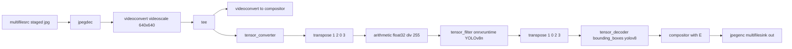

# Plan — COCO128 images through nnstreamer with a YOLO model (x86 Ubuntu host)

## Goal

A small GStreamer project that reads the **COCO128** dataset images, runs a
**YOLO** model inside an **nnstreamer** inference step, draws the detected
**bounding boxes** and writes the annotated images to `out/`. It targets the
current **x86_64 Ubuntu** host and ships an idempotent installer plus a
preparation script. All comments are in English.

Constraint from review: **no repository cloning and no source compilation** —
nnstreamer comes from a PPA, the rest from apt/pip.

## Confirmed environment

| Item | Value |
|------|-------|
| OS / arch | Ubuntu 24.04.5 LTS, x86_64 |
| GStreamer | 1.24.2 |
| nnstreamer | `2.7.0.0` from `ppa:nnstreamer/ppa` (`nnstreamer`, `nnstreamer-onnxruntime`) |
| ONNX backend name | `onnxruntime` (reported by `gst-inspect-1.0 tensor_filter`) |
| Model | `yolov8n.onnx` — input `images [1,3,640,640]`, output `output0 [1,84,8400]` |
| Dataset | COCO128, 128 images |

## Deliverables

```text
scripts/setup.sh            apt + nnstreamer PPA + pip venv, idempotent
scripts/prepare.sh          download COCO128, export YOLOv8n ONNX, write labels
scripts/coco128_yolo.sh     the detection pipeline (config at the top)
scripts/requirements.txt    runtime Python deps
scripts/requirements-export.txt  model-export Python deps
README.md                   usage, design notes, troubleshooting
```

## Pipeline

```text
multifilesrc (staged coco128/*.jpg)
  ! jpegdec ! videoconvert ! videoscale ! video/x-raw,RGB,640x640
  ! tee name=t
      t. ! queue ! videoconvert                                     ! mix.sink_0
      t. ! queue ! tensor_converter
                 ! tensor_transform mode=transpose option=1:2:0:3
                 ! tensor_transform mode=arithmetic option=typecast:float32,div:255.0
                 ! tensor_filter framework=onnxruntime model=assets/models/yolov8n.onnx
                 ! tensor_transform mode=transpose option=1:0:2:3
                 ! tensor_decoder mode=bounding_boxes option1=yolov8 option2=<labels>
                     option3=1:0.25:0.45 option4=640:640 option5=640:640
                 ! queue                                            ! mix.sink_1
  ! compositor name=mix ! videoconvert ! jpegenc ! multifilesink location=out/detected_%04d.jpg
```



## Key implementation findings

1. **multifilesrc needs a printf pattern**, not a glob. The script stages the
   sorted images as symlinks `img_%04d.jpg` and drives multifilesrc with
   `start-index`/`stop-index`; `--limit` simply caps how many are staged.
2. **Input layout** — `tensor_converter` (RGB) emits a
   `[channels][width][height][frames]` tensor whose memory is interleaved HWC.
   The onnxruntime filter expects the reversed model dims
   `[height][width][channels][batch]`, so `option=1:2:0:3` is required; the raw
   (untransposed) layouts were inspected and confirmed.
3. **Output layout** — the filter returns the raw ONNX output (class-major
   `[84][8400]`), but `tensor_decoder` reads a box-major buffer
   (`buffer[box*84 + class]`), so `option=1:0:2:3` is required. Verified by
   dumping both tensors and comparing against an onnxruntime reference.
4. **`option3` first field** must be `1`: ultralytics ONNX box coordinates are
   already in input pixels, and the decoder multiplies by the input size when
   this field is `0`, pushing every box off-frame (invisible).
5. **compositing** — the decoder output is RGBA with a transparent background,
   so it is composited over the source frame with `compositor` (fallback
   `videomixer`).

## Verification performed

- `prepare.sh` produced 128 images, `yolov8n.onnx` (12.3 MB) and 80 labels.
- A Python onnxruntime reference reported 9–20 detections per image.
- The pipeline ran over 5 images and then all 128 images (clean EOS, ~18 s),
  writing `out/detected_0000.jpg .. out/detected_0127.jpg`.
- Boxes were visually confirmed, e.g. `zebra` on a zebra image and
  `bowl`/`broccoli` on a food image.

## Usage

```sh
scripts/setup.sh            # install only what is missing (sudo password)
scripts/prepare.sh          # download dataset + export model + labels
scripts/coco128_yolo.sh     # run over all images into out/
scripts/coco128_yolo.sh --limit 5
scripts/coco128_yolo.sh --display
```
